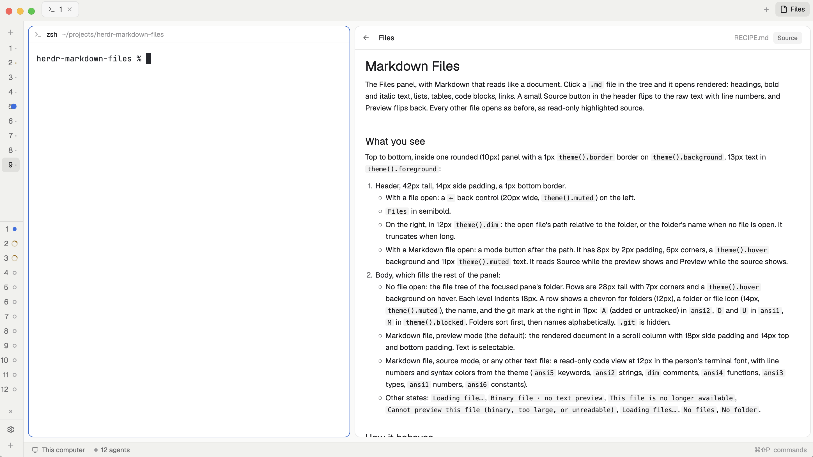

# Markdown Files for Herdr

A [Herdr](https://herdr.dev) desktop mod: the Files panel, with Markdown that renders. Click a `.md` file and it opens as a formatted document. A **Source** button in the header shows the raw text, and **Preview** switches back. All other files open as before.



## Install

Ask the agent in your Herdr window:

> Add the mod at github.com/cmarin/herdr-markdown-files

Or do it by hand:

1. Copy `mods/markdown-files/` to `~/.config/herdr-app/mods/markdown-files/`.
2. Clone your layout, because Herdr's own layouts are read-only:
   ```sh
   herdr-app do layout.clone '{"name":"main","as":"main-md"}'
   ```
3. In `~/.config/herdr-app/layouts/main-md.json`, find `"mod": "files"` and change it to `"mod": "markdown-files"`.
4. Check it:
   ```sh
   herdr-app check ~/.config/herdr-app/mods/markdown-files
   ```
5. Click **Files** at the top right of the window and open a `.md` file.

To undo, switch back to the `main` layout from the command palette.

## What it does and does not do

- It reads files in the focused pane's folder, and runs `sh` and `git` (and `powershell` on Windows) to list folders and show git marks, the same as Herdr's own Files panel.
- It does not reach the network and does not write files.

`RECIPE.md` describes the mod in full, so that an agent can rebuild it from scratch.

## License

Apache-2.0. This mod is a modified copy of Herdr's shipped `files` mod (version 0.1.15, Apache-2.0, © Herdr). The change: a rendered Markdown preview with a Source/Preview toggle. See `LICENSE`.
