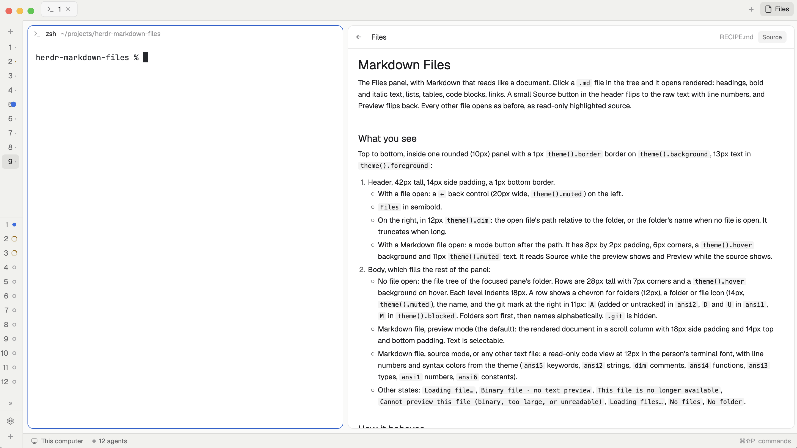

# Markdown Files

The Files panel, with Markdown that reads like a document. Click a `.md` file in the tree and it opens rendered: headings, bold and italic text, lists, tables, code blocks, links. A small **Source** button in the header flips to the raw text with line numbers, and **Preview** flips back. Every other file opens as before, as read-only highlighted source.

## What you see

Top to bottom, inside one rounded (10px) panel with a 1px `theme().border` border on `theme().background`, 13px text in `theme().foreground`:

1. **Header**, 42px tall, 14px side padding, a 1px bottom border.
   - With a file open: a `←` back control (20px wide, `theme().muted`) on the left.
   - `Files` in semibold.
   - On the right, in 12px `theme().dim`: the open file's path relative to the folder, or the folder's name when no file is open. It truncates when long.
   - With a Markdown file open: a mode button after the path. It has 8px by 2px padding, 6px corners, a `theme().hover` background and 11px `theme().muted` text. It reads **Source** while the preview shows and **Preview** while the source shows.
2. **Body**, which fills the rest of the panel:
   - **No file open:** the file tree of the focused pane's folder. Rows are 28px tall with 7px corners and a `theme().hover` background on hover. Each level indents 18px. A row shows a chevron for folders (12px), a folder or file icon (14px, `theme().muted`), the name, and the git mark at the right in 11px: `A` (added or untracked) in `ansi2`, `D` and `U` in `ansi1`, `M` in `theme().blocked`. Folders sort first, then names alphabetically. `.git` is hidden.
   - **Markdown file, preview mode (the default):** the rendered document in a scroll column with 18px side padding and 14px top and bottom padding. Text is selectable.
   - **Markdown file, source mode, or any other text file:** a read-only code view at 12px in the person's terminal font, with line numbers and syntax colors from the theme (`ansi5` keywords, `ansi2` strings, `dim` comments, `ansi4` functions, `ansi3` types, `ansi1` numbers, `ansi6` constants).
   - **Other states:** `Loading file…`, `Binary file · no text preview`, `This file is no longer available`, `Cannot preview this file (binary, too large, or unreadable)`, `Loading files…`, `No files`, `No folder`.

## How it behaves

- The tree follows the focused pane: focus a terminal in another folder or on another machine and the tree switches to that folder. Each folder remembers which subfolders were open and which file was showing.
- Click a folder to expand or collapse it. Collapsing a folder also collapses everything under it. Click a file to open it. Click `←` to go back to the tree.
- A file whose name ends in `.md`, `.markdown`, `.mdx`, `.mdown` or `.mkd` (any letter case) opens in preview mode. The mode button switches between preview and source. The choice stays in effect for the next Markdown file opened.
- The tree and git marks refresh when files change in a local folder, and every 10 seconds in any case.
- Agent status does not show in this panel.

## Built from

- One mod, `mods/markdown-files/`: `main.js`, `mod.json` (`{ "place": "none" }`), and the four icons `chevron-down.svg`, `chevron-right.svg`, `file.svg`, `folder.svg`.
- It is Herdr's shipped `files` mod (version 0.1.15) with one addition: the Markdown preview. The tree, the git marks and the code view are unchanged.
- `main.js` is one `View` class. Imports: `View`, `div`, `svg` from `gpui-kit`. `v_flex`, `h_flex`, `Editor`, `EditorState`, `TextView` from `gpui-base`. `spaces`, `panes`, `focused`, `exec`, `readTextFile`, `watchFolder`, `theme`, `settings`, `window` from `herdr`.
- The preview is `TextView.markdown(id, text).selectable(true)` inside a `v_flex().overflow_y_scrollbar()`. The source view is `Editor.new(EditorState.new({ language, readonly: true, value, font_family: settings().font_family, font_size: 12, syntax }))`.
- `show(path)` reads the file with `readTextFile`. When the name is Markdown, it keeps the text for the preview and also builds the code view for source mode.
- Programs it runs, through `exec`: `sh` to list a folder, and `git rev-parse --show-toplevel` and `git --no-optional-locks -c core.fsmonitor=false status --porcelain=v1 -z --no-renames --untracked-files=all` for the marks. On Windows, `powershell` lists folders. It reads files in the focused pane's folder (local or on a connected machine). It does not reach the network and does not write files.
- No props and no keys.

## Watch out

- Herdr's own layouts and mods are read-only and are replaced on every start. Do not edit the shipped `files` mod. To use this mod, clone a layout (`herdr-app do layout.clone '{"name":"main","as":"main-md"}'`) and, in the clone's JSON, change the block whose `content.mod` is `"files"` to `"markdown-files"`. In the `main` layout that block sits in a stack beside `changes`, and the header's **Files** button shows it.
- `mod.json` uses `"place": "none"`, so the mod docks nowhere by itself. Without the layout change above, nothing appears.
- Icon paths in `main.js` must name the mod's own folder (`mods/markdown-files/…`). A rename must update them.
- Give each Markdown `TextView` an id that includes the file path, so that opening another file renders it fresh.
- Files over 400,000 characters are cut at that point, with a `… (file truncated)` line.
- The tree lists at most 500 entries per folder and 5,000 in total, and then shows a notice.
- `.mdx` is rendered as plain Markdown; JSX in it shows as text.

## Done when

- `herdr-app check ~/.config/herdr-app/mods/markdown-files` passes.
- With the cloned layout active, the header's **Files** button shows the tree of the focused pane's folder, with git marks on changed files.
- Clicking a `.md` file shows rendered headings, lists and tables, not `#` and `-` characters.
- The header shows **Source**. Clicking it shows the raw Markdown with line numbers and the button reads **Preview**. Clicking it again shows the rendered view.
- Clicking a `.ts` or `.json` file shows highlighted read-only source and no mode button.
- `←` returns to the tree with the same folders still open.
