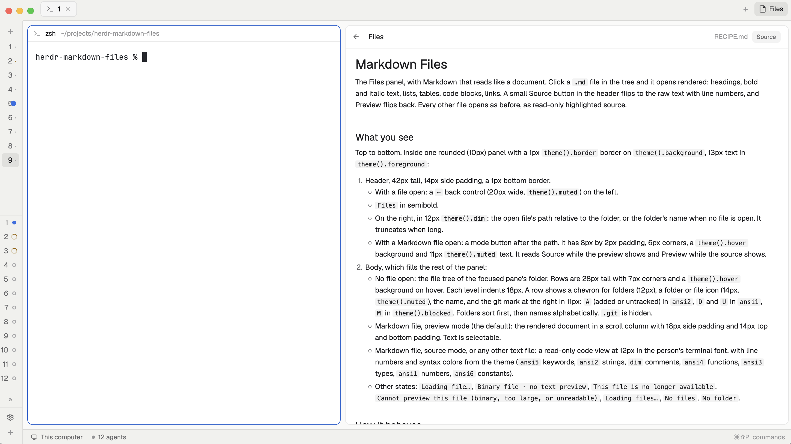

# Better Files

The Files panel, improved four ways. Markdown files open rendered: headings, bold and italic text, lists, tables, code blocks, links. A header button sorts the tree by name or by modification time, so the newest file in a folder can sit at the top. A search field filters every file under the folder. Right-click a file or folder and its path is typed into the focused terminal, as if dropped from Finder. Every other file opens as before, as read-only highlighted source.

## What you see

Top to bottom, inside one rounded (10px) panel with a 1px `theme().border` border on `theme().background`, 13px text in `theme().foreground`:

1. **Header**, 42px tall, 14px side padding, a 1px bottom border.
   - With a file open: a `←` back control (20px wide, `theme().muted`) on the left.
   - `Files` in semibold.
   - On the right, in 12px `theme().dim`: the open file's path relative to the folder, or the folder's name when no file is open. It truncates when long.
   - After the path, one small button. It has 8px by 2px padding, 6px corners, a `theme().hover` background and 11px `theme().muted` text:
     - With no file open (the tree): the sort button. It reads **Name A–Z**, **Name Z–A**, **Newest** or **Oldest**.
     - With a Markdown file open: the mode button. It reads **Source** while the preview shows and **Preview** while the source shows.
2. **Search field**, only while no file is open: 30px tall, 8px from the panel's sides, 8px below the header and 2px above the body. It has 9px side padding, 7px corners, a 1px border (`theme().accent` while it has the keyboard, else `theme().border`) and a `theme().background` fill. Inside: a 13px search icon in `theme().dim`, the text input at 12px with the placeholder `Search files…`, and, while it holds text, a `×` clear control in 13px `theme().dim` (`theme().foreground` on hover).
3. **Body**, which fills the rest of the panel:
   - **Search text typed, no file open:** a flat list of matching files in place of the tree. Rows are 28px tall with 7px corners and the hover background, like tree rows, with no indent. A row shows the file icon, the file name, then its folder path (relative to the panel's folder) in 11px `theme().dim`, truncated, and the git mark at the right. At most 200 rows show. Below them, in 12px `theme().dim`: `Searching…` until the first file list is read, `No matching files`, or `200 of N matches · type more to narrow`. If the folder holds more than 50,000 files, an 11px line reads `Search covers the first 50,000 files`.
   - **No file open:** the file tree of the focused pane's folder. Rows are 28px tall with 7px corners and a `theme().hover` background on hover. Each level indents 18px. A row shows a chevron for folders (12px), a folder or file icon (14px, `theme().muted`), the name, and the git mark at the right in 11px: `A` (added or untracked) in `ansi2`, `D` and `U` in `ansi1`, `M` in `theme().blocked`. Folders come first, then entries in the chosen sort order. `.git` is hidden.
   - **Markdown file, preview mode (the default):** the rendered document in a scroll column with 18px side padding and 14px top and bottom padding. Text is selectable.
   - **Markdown file, source mode, or any other text file:** a read-only code view at 12px in the person's terminal font, with line numbers and syntax colors from the theme (`ansi5` keywords, `ansi2` strings, `dim` comments, `ansi4` functions, `ansi3` types, `ansi1` numbers, `ansi6` constants).
   - **Other states:** `Loading file…`, `Binary file · no text preview`, `This file is no longer available`, `Cannot preview this file (binary, too large, or unreadable)`, `Loading files…`, `No files`, `No folder`.

## How it behaves

- The tree follows the focused pane: focus a terminal in another folder or on another machine and the tree switches to that folder. Each folder remembers which subfolders were open and which file was showing.
- Click a folder to expand or collapse it. Collapsing a folder also collapses everything under it. Click a file to open it. Click `←` to go back to the tree.
- **Sorting.** Each click on the sort button moves to the next order: Name A–Z, Name Z–A, Newest, Oldest, then back to Name A–Z. Newest and Oldest use each entry's modification time, with the name breaking ties. Folders always stay above files. The order applies to every folder and is kept in the mod's `localStorage` under `sort`, so it survives a restart.
- **Search.** Click the field and type. Matching ignores letter case and splits the text on spaces: every word must occur somewhere in the file's path relative to the panel's folder, so `board page` finds `src/pages/BoardPage.tsx`. Order: files whose name starts with the first word, then files whose name holds more of the words, then shorter paths, then A–Z. Click a result to open it; Enter opens the first one. `←` from that file returns to the same results. Escape (while the field has the keyboard) or `×` clears the text and shows the tree again. Right-click on a result inserts its path, as in the tree. Switching to another folder clears the search.
  - The file list is read the first time you type in a folder. In a git work tree it is `git ls-files -z --cached --others --exclude-standard`, run in the panel's folder, so it covers tracked and untracked files under that folder and leaves out ignored ones. Elsewhere it is `find . ( -name .git -o -name node_modules ) -prune -o ( -type f -o -type l ) -print0`, cut at 8,000,000 bytes, and on a local Windows folder `Get-ChildItem -Recurse -File -Force -Name` without `.git` and `node_modules` paths. At most 50,000 paths are kept.
  - Each tree refresh (a file change, or the 10-second timer) marks the list out of date. While text is in the field, the list is read again in the background, and the old results stay on screen until the new list arrives. Results are computed once per query and file list, not on every draw.
- **Right-click a row** (file or folder) to type `<folder>/<path>` into the focused terminal, followed by a space and no Enter, the same as a Finder drop. Quoting:
  - POSIX shells: characters other than letters, digits and `_-.,:/@%+=` get a backslash (`/a/my\ notes.md `). A path with a control character, such as a newline, is written as `$'…'` with `\xNN` escapes.
  - Windows (a local Windows folder): native `\` separators inside PowerShell single quotes, with quote characters doubled (`'C:\a\it''s.txt' `).
- It works by putting the text on the clipboard and running `terminal.paste`:
  - On macOS it first saves every clipboard item, in every type, to a new folder from `mktemp -d "$TMPDIR/herdr-better-files.XXXXXX"`. 400 ms after the paste it puts them back and deletes the folder. If something else was copied in between, it keeps the new copy. If the clipboard carries `org.nspasteboard.ConcealedType` or `org.nspasteboard.TransientType` (a password manager's), nothing is saved and the path stays on the clipboard.
  - On Linux (`wl-copy`, else `xclip`) and Windows (`Set-Clipboard`) the path stays on the clipboard.
  - A second right-click while one is in progress does nothing.
- A file whose name ends in `.md`, `.markdown`, `.mdx`, `.mdown` or `.mkd` (any letter case) opens in preview mode. The mode button switches between preview and source. The choice stays in effect for the next Markdown file opened.
- The tree and git marks refresh when files change in a local folder, and every 10 seconds in any case.
- Agent status does not show in this panel.

## Built from

- One mod, `mods/better-files/`: `main.js`, `mod.json` (`{ "place": "none" }`), and the five icons `chevron-down.svg`, `chevron-right.svg`, `file.svg`, `folder.svg`, `search.svg`.
- It is Herdr's shipped `files` mod (version 0.1.15) with four additions: the Markdown preview, sorting, search and path insertion. The git marks and the code view are unchanged.
- `main.js` is one `View` class. Imports: `View`, `div`, `svg` from `gpui-kit`. `v_flex`, `h_flex`, `Editor`, `EditorState`, `TextView`, `InputState`, `Input` from `gpui-base`.
- The search field is `Input.new(state)`, where `state` is one `InputState.new({ placeholder: "Search files…" })` made in `init` (never in `render`). Its `change` event stores the trimmed text and starts the file list read; `submit` opens the first result; `focus` and `blur` set the border color. The field's frame takes `.on_mouse_down("left", …)` to focus the input and `.on_key_down` for Escape. `spaces`, `panes`, `focused`, `exec`, `readTextFile`, `watchFolder`, `theme`, `settings`, `window`, `run` from `herdr`.
- The preview is `TextView.markdown(id, text).selectable(true)` inside a `v_flex().overflow_y_scrollbar()`. The source view is `Editor.new(EditorState.new({ language, readonly: true, value, font_family: settings().font_family, font_size: 12, syntax }))`.
- Folder listing: one `sh` script prints `kind\0name\0` pairs (at most 5,001), then a `t\0` marker, then one modification time per line from a single `stat` call over all the entries (`stat -c %Y` where GNU stat answers, else BSD `stat -f %m`). If that call fails, for example because a file was removed during the listing, each entry is `stat`ed alone and a missing one gets `0`. If the count of times still does not match the count of entries, the times are dropped and Newest/Oldest fall back to name order. On Windows, `powershell` returns `mtime` from `LastWriteTimeUtc`.
- The whole listing is kept, with a `cap` of how many entries the tree shows (500 per folder, 5,000 in total). The cut is made after sorting, so Newest shows the newest files of a large folder.
- Sorting happens when the tree is drawn (`rows()`), not when a folder loads, so changing the order needs no reload. Each loaded folder's sorted list is cached (a `WeakMap` keyed by the loaded array) until the order changes or the folder reloads.
- The row's right-click is `.on_mouse_down("right", …)` with `cx.stop_propagation()`. The macOS clipboard save and restore is a JXA script run through `osascript -l JavaScript -e`, using `NSPasteboard` `pasteboardItems`, `dataForType` and `writeObjects`. The restore step deletes the temporary folder itself, and it also runs when the swap fails. The Windows command passes the path as `& { param($p) Set-Clipboard -Value $p } '<path>'`, because `powershell -Command` joins all later arguments into the command text.
- Programs it runs, through `exec`: `sh` and `stat` to list a folder; `git rev-parse --show-toplevel` and `git --no-optional-locks -c core.fsmonitor=false status --porcelain=v1 -z --no-renames --untracked-files=all` for the marks; `osascript`, `wl-copy`, `xclip` or `powershell` for the clipboard. On Windows, `powershell` lists folders. It reads files in the focused pane's folder (local or on a connected machine). It does not reach the network.
- No props and no keys.

## Watch out

- Herdr's own layouts and mods are read-only and are replaced on every start. Do not edit the shipped `files` mod. To use this mod, clone a layout (`herdr-app do layout.clone '{"name":"main","as":"main-better-files"}'`) and, in the clone's JSON, change the block whose `content.mod` is `"files"` to `"better-files"`. In the `main` layout that block sits in a stack beside `changes`, and the header's **Files** button shows it.
- `mod.json` uses `"place": "none"`, so the mod docks nowhere by itself. Without the layout change above, nothing appears.
- Icon paths in `main.js` must name the mod's own folder (`mods/better-files/…`). A rename must update them. `localStorage` belongs to each mod copy, so a renamed copy starts at Name A–Z.
- Mods cannot start a drag that a terminal accepts, which is why path insertion is a right-click. `terminal.paste` goes to the focused terminal, not the one under the pointer.
- On Linux, right-click needs `wl-copy` (Wayland) or `xclip` (X11). Send their output to `/dev/null`: both leave a process running that holds the clipboard, and a captured output pipe would keep `exec` waiting until its timeout.
- On a connected machine the path is that machine's path, quoted for a POSIX shell, while the clipboard is this computer's.
- Herdr's paste reads the clipboard, so the clipboard has to hold the path for a moment. Restore no sooner than a few hundred milliseconds after `run("terminal.paste")`, and compare `changeCount` so that a copy made in between is not overwritten.
- Modification time changes on every edit, so Newest shows the most recently edited file, not the most recently created one.
- Give each Markdown `TextView` an id that includes the file path, so that opening another file renders it fresh.
- Files over 400,000 characters are cut at that point, with a `… (file truncated)` line.
- The tree shows at most 500 entries per folder and 5,000 in total, and then shows a notice. Each folder's listing reads up to 5,001 entries, so the sort sees all of them in folders up to that size.
- `.mdx` is rendered as plain Markdown; JSX in it shows as text.
- `git ls-files` prints paths relative to the folder it runs in, and only for files under it, so a pane in a subfolder of a repository searches that subfolder. Search finds files only, not folders.
- On a connected machine, search runs `git` or `sh` there, like the tree does.

## Done when

- `herdr-app check ~/.config/herdr-app/mods/better-files` passes.
- With the cloned layout active, the header's **Files** button shows the tree of the focused pane's folder, with git marks on changed files. On a first install the sort button reads **Name A–Z**.
- Clicking the sort button until it reads **Newest** puts the most recently modified file at the top of each expanded folder, with folders still above files. The order is the same after a restart.
- Right-clicking `my notes.md` with a terminal focused types `/…/my\ notes.md ` at the prompt without pressing Enter. On macOS, the clipboard afterwards holds what it held before, and no `herdr-better-files.*` folder is left in `$TMPDIR`.
- Clicking a `.md` file shows rendered headings, lists and tables, not `#` and `-` characters. The header shows **Source**. Clicking it shows the raw Markdown with line numbers and the button reads **Preview**.
- Typing `readme` in the search field lists every README under the folder, including ones in folders that are not expanded, and no files under `node_modules` in a git repository. Enter opens the first; `←` comes back to the same list; Escape shows the tree again.
- Clicking a `.ts` or `.json` file shows highlighted read-only source and no mode button.
- `←` returns to the tree with the same folders still open.
